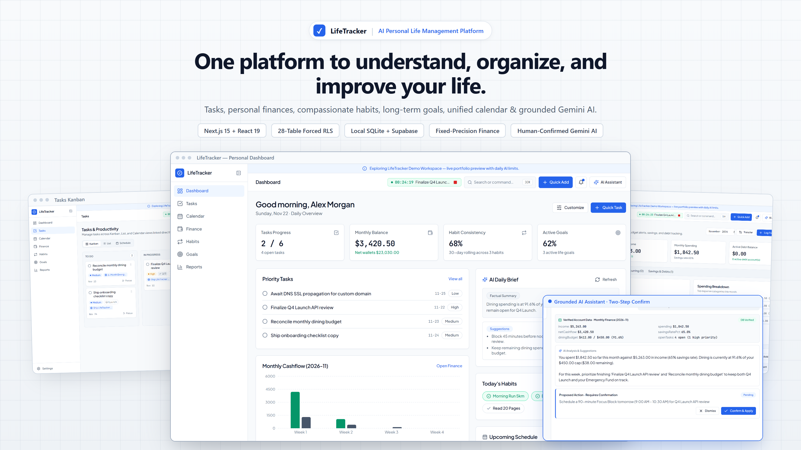
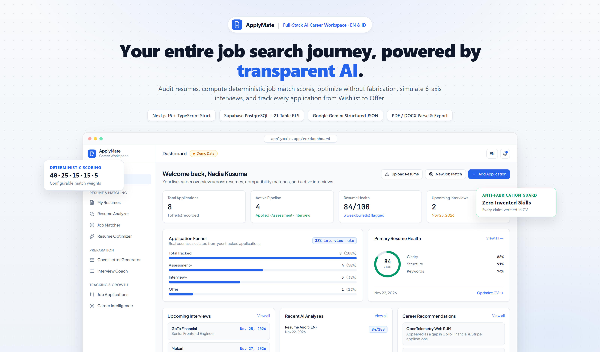

# Hi, I'm Zaa

**Junior Software Developer · Android & Application Development**

Recent Informatics (Bachelor's) graduate focused on building practical Android and full-stack software applications. I work primarily with **Kotlin** and **Java**, alongside modern backend, database, and AI tooling including **Supabase**, **REST APIs**, **Google Gemini API**, and **Docker**. Backed by hands-on troubleshooting from an IT Support internship and a vocational Computer Networking (TKJ) background, I focus on writing clean, reliable software and continuously strengthening my engineering fundamentals.

[GitHub](https://github.com/Zaacodez) · [Email](mailto:nandamailwork@gmail.com)

---

## Technical Skills

| Category | Technologies |
| :--- | :--- |
| **Programming Languages** |    |
| **Mobile Development** |   |
| **Web Development** |   |
| **Backend & Database** |     |
| **AI Integration** |  |
| **Tools & Environment** |    |
| **Additional Knowledge** |    |

---

## Featured Projects

### BukuKita — Android Bookstore Catalog & AI Assistant

Bilingual (English & Bahasa Indonesia) native Android bookstore catalog and conversational book concierge built for **Toko Buku Semut Alas**, pairing a clean editorial reading interface with live catalog-grounded AI assistance.

- **Stack:** Kotlin, Jetpack Compose, Material Design 3, Android, Supabase (Auth, PostgREST, Storage), Room SQLite, Retrofit (REST API), Google Gemini API
- **Key Features:**
  - Curated home shelves, debounced live search (`StateFlow`), dynamic category filters, and editorial book detail screens with real-time stock status.
  - Grounded AI bookstore assistant (*Asisten BukuKita*) backed by live Supabase catalog pricing/stock lookups and Room-persisted conversation memory.
  - Email or username sign-in via Supabase, profile avatar uploads, bilingual EN/ID switching, and Light/Dark design tokens verified with WCAG AA contrast unit tests.
- **Repository:** [github.com/Zaacodez/BukuKita](https://github.com/Zaacodez/BukuKita)

---

### LifeTracker — Personal Life Management & Productivity Platform

Unified personal management application connecting tasks, fixed-precision personal finance, habits, goals, calendar scheduling, and a grounded AI assistant inside a single relational workspace.

- **Stack:** Next.js 15, React 19, TypeScript, Tailwind CSS, Supabase (PostgreSQL + Row-Level Security), SQLite, Google Gemini API, Docker
- **Key Features:**
  - Integrated modules for Kanban task management & focus timer, multi-wallet personal finance ledger, 30-day habit heatmaps, goal rollups, and a 5-layer unified calendar.
  - Grounded Google Gemini assistant separating verified account data from AI suggestions, with two-step user confirmation before write actions.
  - Dual database mode (zero-Docker local SQLite or Supabase PostgreSQL with 28-table Forced RLS) alongside multi-stage Docker Compose deployment.
- **Repository:** Private repository (planned for public release)

---

### ApplyMate — AI-Powered Job Application Workspace

Bilingual (English & Bahasa Indonesia) job application workspace combining structured resume audits, deterministic job-description matching, truthful CV optimization, mock interview practice, and pipeline tracking.

- **Stack:** Next.js 16, React 19, TypeScript, Tailwind CSS, Supabase (PostgreSQL + RLS + Private Storage), Google Gemini API, Vitest
- **Key Features:**
  - PDF/DOCX resume upload with structured AI rubric feedback and deterministic weighted job-description compatibility scoring.
  - Diff-based Resume Optimizer with an anti-fabrication guard, grounded Cover Letter generator, and clean PDF/DOCX export.
  - Interactive AI Interview Coach with 6-axis evaluation reports, 7-stage Kanban application tracker, and skill-gap learning roadmaps.
- **Repository:** Local project (pending public GitHub release)

---

## GitHub Overview

  <picture>
    <source media="(prefers-color-scheme: dark)" srcset="https://github-readme-stats.vercel.app/api?username=Zaacodez&show_icons=true&hide_border=true&bg_color=0D1117&title_color=E2E8F0&text_color=94A3B8&icon_color=3B82F6" />
    <source media="(prefers-color-scheme: light)" srcset="https://github-readme-stats.vercel.app/api?username=Zaacodez&show_icons=true&hide_border=true&bg_color=FFFFFF&title_color=0F172A&text_color=475569&icon_color=2563EB" />
    
  </picture>
  <picture>
    <source media="(prefers-color-scheme: dark)" srcset="https://github-readme-stats.vercel.app/api/top-langs/?username=Zaacodez&layout=compact&hide_border=true&bg_color=0D1117&title_color=E2E8F0&text_color=94A3B8" />
    <source media="(prefers-color-scheme: light)" srcset="https://github-readme-stats.vercel.app/api/top-langs/?username=Zaacodez&layout=compact&hide_border=true&bg_color=FFFFFF&title_color=0F172A&text_color=475569" />
    
  </picture>

Contribution Streak

 
<picture>
  <source media="(prefers-color-scheme: dark)" srcset="https://streak-stats.demolab.com/?user=Zaacodez&hide_border=true&background=0D1117&ring=3B82F6&fire=3B82F6&currStreakLabel=E2E8F0&sideLabels=94A3B8&dates=64748B&currStreakNum=F8FAFC&sideNums=F8FAFC" />
  <source media="(prefers-color-scheme: light)" srcset="https://streak-stats.demolab.com/?user=Zaacodez&hide_border=true&background=FFFFFF&ring=2563EB&fire=2563EB&currStreakLabel=0F172A&sideLabels=475569&dates=64748B&currStreakNum=0F172A&sideNums=0F172A" />
  
</picture>

---

## Connect

Open to Junior Software Developer, Android Developer, and entry-level application engineering opportunities.

- **GitHub:** [github.com/Zaacodez](https://github.com/Zaacodez)
- **Email:** [napcodezx@gmail.com](mailto:napcodezx@gmail.com)
